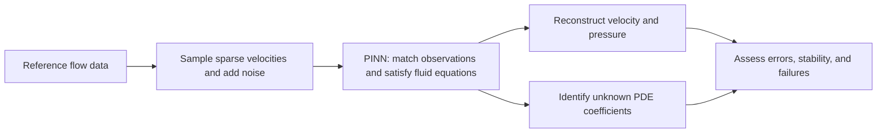
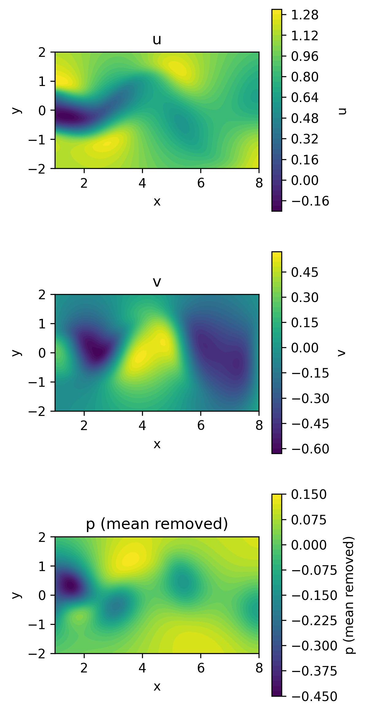
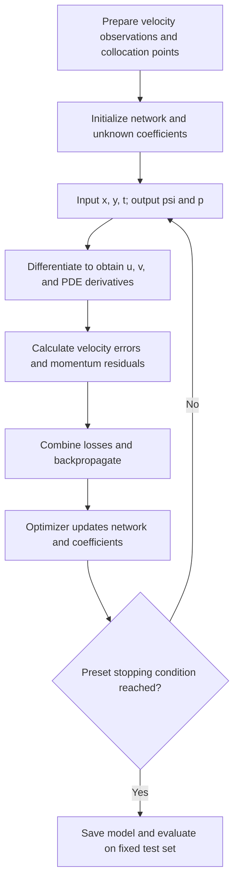

# Understanding Our SciML Project: Inferring Fluid Parameters and Pressure from Sparse Velocity Observations

[中文版 / Chinese version](PROJECT_GUIDE.md)

> **Audience:** Students, teammates, and reviewers encountering this project for the first time. No prior knowledge of PINNs is required.
>
> **How to read this guide:** Start with the two-minute overview, then work through the equations, method, and experiments. Equations use GitHub-compatible LaTeX, and flowcharts use Mermaid.
>
> **Project status | 2026-11-04:** The reference dataset has been downloaded and checked, and reference snapshots and an animation are available. The core PINN computations, training, and evaluation are still interfaces awaiting implementation. The learning capabilities described below are research objectives; no training results have demonstrated them yet.

## The Two-Minute Overview: What Are We Trying to Do?

Imagine water flowing past a circular cylinder, producing a wake that changes over time. Suppose we know the velocity at only a small number of locations and times. We want to answer:

> **Can we combine these velocity observations with known fluid equations to infer unobserved pressure, reconstruct velocity elsewhere, and identify unknown coefficients in the equations? How well does the method work as observations become fewer and noisier?**

Our method is a **Physics-Informed Neural Network (PINN)**.

The network learns a continuous function of spatial position and time. During training, we ask its predicted velocities to match the observations and its predicted flow to approximately satisfy the Navier–Stokes equations.

The overall project follows this sequence:



If your reader does not support flowcharts, the same sequence is:

**Reference data → sparse, noisy velocities → training with physics constraints → field reconstruction and parameter identification → error and limitation analysis.**

We are studying the method's performance and limits. Producing an attractive flow visualization is only one part of checking the results.

## Contents

1. [The Physical Setting: Flow Behind a Cylinder](#1-the-physical-setting-flow-behind-a-cylinder)
2. [What Is Known and What Are We Trying to Infer?](#2-what-is-known-and-what-are-we-trying-to-infer)
3. [What Do the Navier–Stokes Equations Describe?](#3-what-do-the-navierstokes-equations-describe)
4. [Why Is This an Inverse Problem?](#4-why-is-this-an-inverse-problem)
5. [How Does a PINN Represent the Flow?](#5-how-does-a-pinn-represent-the-flow)
6. [How Do Physics Constraints Enter Training?](#6-how-do-physics-constraints-enter-training)
7. [What Happens During a Training Run?](#7-what-happens-during-a-training-run)
8. [How Can We Reconstruct Pressure Without Pressure Observations?](#8-how-can-we-reconstruct-pressure-without-pressure-observations)
9. [What Is in the Dataset?](#9-what-is-in-the-dataset)
10. [Which Experiments Are Planned?](#10-which-experiments-are-planned)
11. [How Will We Evaluate the Results?](#11-how-will-we-evaluate-the-results)
12. [What Could Go Wrong?](#12-what-could-go-wrong)
13. [How Do These Concepts Map to the Repository?](#13-how-do-these-concepts-map-to-the-repository)
14. [Frequently Asked Questions and Next Steps](#14-frequently-asked-questions-and-next-steps)
15. [Sources and Further Reading](#15-sources-and-further-reading)

## 1. The Physical Setting: Flow Behind a Cylinder

When water or air flows past a cylinder, vortices may be shed alternately into the wake. Describing this phenomenon requires:

- **Spatial position:** The horizontal coordinate $x$ and vertical coordinate $y$.
- **Time:** $t$.
- **Velocity:** The horizontal component $u(x,y,t)$ and vertical component $v(x,y,t)$.
- **Pressure:** $p(x,y,t)$.

A **field** assigns a number or vector to each location in a region. For example, a velocity plot shows the flow at different locations at one instant; an animation shows how those values change over time.

Our project uses a two-dimensional, incompressible model with constant viscosity and reference cylinder-wake data provided by the original authors.

**The actual region we study is a rectangular window downstream of the cylinder:**

$$
x\in[1,8],\qquad y\in[-2,2],\qquad t\in[0,19.9].
$$

This window does not contain the complete cylinder boundary. Our current task is reconstruction and identification within this window using scattered velocity observations. Solving the complete flow directly from inlet, cylinder-surface, and outer-boundary conditions would require a separately defined forward problem.

The following figure comes from the reference data we have downloaded:



*Figure: A reference snapshot at $t=10$. Pressure has been centered by subtracting its spatial mean at that time, and spatial rendering uses triangulation-based interpolation. This figure illustrates the data; it is not a PINN prediction.*

You can also open the [reference flow animation](../output/reference_animation.html) to view $u,v,p$ changing together. When browsing the repository on GitHub, you will generally need to download the HTML and open it in a browser to use the playback controls.

## 2. What Is Known and What Are We Trying to Infer?

### 2.1 Information Provided to the Training Algorithm

We provide a set of velocity observations:

$$
\mathcal D_u
=\{(x_i,y_i,t_i,u_i^{\mathrm{obs}},v_i^{\mathrm{obs}})\}_{i=1}^{N_u}.
$$

Each record means: **at location $(x_i,y_i)$ and time $t_i$, we measured both velocity components.**

We also specify the form of the governing fluid equations, while allowing training to estimate two of their coefficients.

Here, “100 observation points” means **100 space–time records**, each containing both $u$ and $v$. It does not mean 100 fixed sensors that each record all 200 time steps.

### 2.2 Information We Want the Model to Recover

After training, we want:

- **Velocity reconstruction:** $\hat u(x,y,t)$ and $\hat v(x,y,t)$.
- **Pressure reconstruction:** $\hat p(x,y,t)$; more precisely, a pressure distribution that can be compared after removing the arbitrary pressure-reference offset.
- **Parameter identification:** Two global scalars, $\hat\lambda_1,\hat\lambda_2$.

The hat symbol $\hat{\phantom{u}}$ indicates a model estimate. Below, the unhatted variables $u,v,p$ denote the ideal flow in the physical equations and the reference solution in evaluation formulas.

### 2.3 The Reference Dataset Contains More Than Training Is Allowed to See

The complete file contains velocity, pressure, and all sampled space–time coordinates. As experiment designers, we can inspect these values to construct and check experiments. Training, however, may use only the selected velocity labels and the governing equations.

**Reference pressure is used for evaluation, not in the training loss. Held-out velocity labels are also excluded from training and from decisions about the training budget.**

This design lets us test how much pressure structure the model can recover without any pressure observations.

## 3. What Do the Navier–Stokes Equations Describe?

The Navier–Stokes equations are often abbreviated as the **NS equations**. In our project, they describe two main requirements:

1. How fluid momentum changes through time dependence, transport, pressure, and viscosity.
2. Local conservation of mass for an incompressible fluid.

### 3.1 Reading the Notation

- $u_t=\partial u/\partial t$: The rate at which horizontal velocity changes over time at a fixed location.
- $u_x=\partial u/\partial x$: The rate at which horizontal velocity changes in the horizontal direction.
- $u_{xx}=\partial^2u/\partial x^2$: The second derivative of horizontal velocity with respect to $x$.
- $p_x,p_y$: The spatial rates of change of pressure, or pressure-gradient components.
- $\nabla$: An operator that collects differentiation in the spatial directions.
- $\nabla^2$: The spatial Laplacian; in two dimensions, it is $\partial_{xx}+\partial_{yy}$.

A **partial derivative** describes how a function changes with respect to one variable while the other variables are held fixed.

### 3.2 The Dimensional Form: Starting from Physical Quantities

For constant density and viscosity, without an explicit body-force term, let the velocity vector be $\mathbf q=(u,v)$. The equations can be written as:

$$
\frac{\partial\mathbf q}{\partial t}
+(\mathbf q\cdot\nabla)\mathbf q
=-\frac{1}{\rho}\nabla p_{\mathrm{phys}}
+\nu\nabla^2\mathbf q,
\qquad
\nabla\cdot\mathbf q=0.
$$

Here, $\rho$ is density, $\nu$ is kinematic viscosity, and $p_{\mathrm{phys}}$ is dimensional pressure. Intuitively, fluid acceleration is determined by pressure and viscous effects.

### 3.3 The Nondimensional Form Used in This Project

Using the scaling convention of the reference example, we write the two momentum equations as:

$$
\boxed{
u_t+\lambda_1(uu_x+vu_y)
=-p_x+\lambda_2(u_{xx}+u_{yy})
}
$$

$$
\boxed{
v_t+\lambda_1(uv_x+vv_y)
=-p_y+\lambda_2(v_{xx}+v_{yy})
}
$$

The incompressibility condition is:

$$
\boxed{u_x+v_y=0.}
$$

The variables $x,y,t,u,v,p$ follow the reference example's nondimensional convention. In particular, $p$ is not raw dimensional pressure that can be interpreted directly in pascals.

Consider the first momentum equation:

- **$u_t$: Local time dependence.** At a fixed location, how is velocity changing over time?
- **$uu_x+vu_y$: Advection.** How does velocity change as fluid moves through a spatially varying velocity field?
- **$-p_x$: The pressure-gradient contribution.** How do pressure differences drive flow in the horizontal direction? Pressure and its gradient are distinct quantities.
- **$\lambda_2(u_{xx}+u_{yy})$: Viscous diffusion.** How does viscosity transfer momentum and smooth velocity differences?

The continuity equation $u_x+v_y=0$ means that the local net volumetric outflow is zero. **It does not mean that velocity is spatially uniform or constant in time.**

### 3.4 What Are the Two Unknown Coefficients?

The reference values in this example are:

$$
\lambda_1^*=1,\qquad\lambda_2^*=0.01.
$$

- $\lambda_1$: The coefficient multiplying the advection terms. Although its true value under the standard scaling is 1, we still estimate it in the inverse problem to test coefficient identification.
- $\lambda_2$: The coefficient multiplying the viscous terms. Under this nondimensional convention, $\lambda_2=1/\mathrm{Re}$.

The Reynolds number is:

$$
\mathrm{Re}=\frac{UL}{\nu},
$$

where $U,L$ are characteristic velocity and length scales. The value $\lambda_2=0.01$ corresponds to $\mathrm{Re}=100$.

**We should therefore describe this task as identifying the viscous coefficient. Recovering dimensional kinematic viscosity also requires the scaling quantities: $\nu=\lambda_2UL$. The two $\lambda$ coefficients should not both be called viscosity.**

## 4. Why Is This an Inverse Problem?

A typical **forward problem** starts with known equation coefficients and sufficient initial and boundary conditions, then computes the flow.

**Our inverse problem** starts with partial velocity observations and infers unknown coefficients and unobserved fields.

```text
Forward: equations + known parameters + initial/boundary conditions -> flow
Inverse: equation structure + partial velocity observations -> unknown parameters + reconstructed fields
```

Both problems use the same physical relationships, but the available information and the quantities being sought differ.

We first plan a reconstruction check that fixes the true coefficients while still using velocity observations. This checks the network, derivatives, and losses. **It is a known-coefficient reconstruction check, rather than a complete cylinder-flow forward solve based only on initial and boundary conditions.**

## 5. How Does a PINN Represent the Flow?

### 5.1 The Network Is a Differentiable Function

Let $\mathcal N_\theta$ denote the network, where $\theta$ contains its weights and biases. The input consists of three numbers:

$$
(x,y,t).
$$

The output consists of two numbers:

$$
\mathcal N_\theta(x,y,t)
=\begin{bmatrix}\psi_\theta(x,y,t)\\p_\theta(x,y,t)\end{bmatrix}.
$$

The quantity $\psi$ is the **stream function**. The default network has 8 hidden layers, 20 neurons per layer, tanh activations, and float64 arithmetic.

A **continuous-time PINN** treats time as a continuous input coordinate. After training, the network can be queried at different coordinates within the window. Being able to return a number does not guarantee that the number is accurate everywhere.

### 5.2 Why Output a Stream Function Instead of Both Velocities Directly?

We define:

$$
\hat u=\frac{\partial\psi_\theta}{\partial y},
\qquad
\hat v=-\frac{\partial\psi_\theta}{\partial x}.
$$

It follows that:

$$
\hat u_x+\hat v_y
=\psi_{\theta,yx}-\psi_{\theta,xy}=0.
$$

For a sufficiently smooth function, the mixed partial derivatives commute, so this representation automatically satisfies continuity. Floating-point calculations may introduce numerical error, so divergence should still be checked.

The network therefore outputs $\psi,p$, from which we obtain all three fields $u,v,p$. No stream-function labels are needed.

### 5.3 What Does Automatic Differentiation Do?

A network is a composition of operations such as addition, multiplication, and activation functions. Automatic differentiation applies the chain rule along this computation graph to calculate derivatives of the outputs with respect to the inputs.

For example, it obtains $\hat u,\hat v$ from $\psi_\theta$, then calculates quantities such as $\hat u_t,\hat u_x,\hat u_{xx}$.

We use derivatives for two different purposes:

- **Derivatives with respect to coordinates:** To recover velocity and the derivatives required by the PDE.
- **Derivatives with respect to trainable parameters:** To determine how to change $\theta,\lambda_1,\lambda_2$ to reduce the loss.

Automatic differentiation differentiates the defined computation graph, subject to floating-point precision. It does not establish that the network is already a correct physical solution.

One implementation detail matters: $u$ is already a first derivative of $\psi$, and the NS equations require second spatial derivatives of velocity. Consequently, third spatial derivatives of $\psi$ are involved. We use smooth tanh activations and normalize inputs inside the network so that the chain rule correctly accounts for coordinate scaling.

## 6. How Do Physics Constraints Enter Training?

The physics information enters by substituting the predictions into the governing equations and measuring how far they are from satisfying those equations.

### 6.1 Physics Residuals: How Far Apart Are the Two Sides?

Move all terms to the left-hand side and define:

$$
f_\theta
=\hat u_t+\lambda_1(\hat u\hat u_x+\hat v\hat u_y)
+\hat p_x-\lambda_2(\hat u_{xx}+\hat u_{yy}),
$$

$$
g_\theta
=\hat v_t+\lambda_1(\hat u\hat v_x+\hat v\hat v_y)
+\hat p_y-\lambda_2(\hat v_{xx}+\hat v_{yy}).
$$

If a prediction satisfies the momentum equations exactly, these residuals are zero. In training, we try to make them sufficiently small at the sampled locations.

Here, $f,g$ represent equation errors, not additional external forces.

### 6.2 Two Types of Points Serve Different Purposes

**Observation points** have velocity labels: $(x_i,y_i,t_i,u_i^{\mathrm{obs}},v_i^{\mathrm{obs}})$. They check agreement between predictions and data.

**Physics collocation points** have only coordinates: $\mathbf z_j^f=(x_j^f,y_j^f,t_j^f)$. They are used to evaluate $f,g$. We can impose physics constraints at locations without velocity measurements.

Thus, “100 velocity observations plus 5,000 physics collocation points” still uses only 100 labeled velocity records. It does not amount to 5,100 velocity measurements.

### 6.3 Data Loss: Do Predictions Match Measurements?

Let $\mathbf z_i=(x_i,y_i,t_i)$. Define:

$$
\mathcal L_{\mathrm{data}}
=\frac{1}{N_u}\sum_{i=1}^{N_u}
\left[
\big(\hat u(\mathbf z_i)-u_i^{\mathrm{obs}}\big)^2
+\big(\hat v(\mathbf z_i)-v_i^{\mathrm{obs}}\big)^2
\right].
$$

A smaller value means that the model more closely matches the supplied velocity labels at observation points. If the labels contain noise, fitting them exactly may also mean fitting that noise.

### 6.4 Physics Loss: Do Predictions Approximately Satisfy the Equations?

$$
\mathcal L_{\mathrm{physics}}
=\frac{1}{N_f}\sum_{j=1}^{N_f}
\left[f_\theta(\mathbf z_j^f)^2+g_\theta(\mathbf z_j^f)^2\right].
$$

Our default total loss is:

$$
\boxed{\mathcal L=\mathcal L_{\mathrm{data}}+\mathcal L_{\mathrm{physics}}.}
$$

Each mean is normalized by its own number of points, so simply adding more collocation points does not directly multiply the weight of the physics term. Even with both weights set to 1, the terms can have different numerical scales, so they must be logged separately.

The stream-function representation already handles continuity. Our current default objective adds neither a separate divergence loss nor a pressure-label loss.

### 6.5 What Does the Model Adjust Simultaneously?

For the inverse problem, we optimize:

$$
\min_{\theta,\lambda_1,\lambda_2}\mathcal L.
$$

The network parameters $\theta$ determine the shape of the fields. The coefficients $\lambda_1,\lambda_2$ are two scalars shared across the entire window and govern the balance between PDE terms.

Because they are updated together, the model can reduce residuals by changing either the fields or the coefficients. A low loss alone therefore does not guarantee correct coefficient identification.

## 7. What Happens During a Training Run?



In pseudocode:

```text
Inputs: velocity observations, physics collocation points, network configuration,
        random seeds, training budget

Initialize network parameters theta
For the inverse problem: initialize and learn lambda1 and lambda2
For the known-coefficient check: fix lambda1=1 and lambda2=0.01

Repeat the prescribed optimization procedure:
    Input coordinates to the network; obtain psi and p
    Differentiate with respect to coordinates to obtain u, v, and PDE derivatives
    Compute data loss at observation points
    Compute physics loss at collocation points
    Differentiate total loss with respect to trainable parameters
    Update the trainable parameters using the optimizer
    Save logs and checkpoints according to the protocol

Save the final state
Access held-out reference velocity and pressure labels only during evaluation
Report parameter errors, field errors, runtime, figures, and failure records
```

Our starting budget is 50,000 Adam steps followed by at most 10,000 L-BFGS iterations. Adam handles the initial optimization, and L-BFGS provides subsequent refinement. This budget needs validation and does not guarantee convergence.

A single L-BFGS iteration can evaluate the loss multiple times, so logs must distinguish optimizer iterations from loss-function evaluations.

**The training iteration number is not physical fluid time.** A training run learns a function across the selected space–time window; an optimizer update is not a one-frame time advance.

## 8. How Can We Reconstruct Pressure Without Pressure Observations?

### 8.1 The Equations Connect Pressure Gradients to Velocity

Rearranging the first momentum equation gives:

$$
p_x=-u_t-\lambda_1(uu_x+vu_y)
+\lambda_2(u_{xx}+u_{yy}).
$$

Similarly, in the other direction:

$$
p_y=-v_t-\lambda_1(uv_x+vv_y)
+\lambda_2(v_{xx}+v_{yy}).
$$

The space–time structure of velocity and the PDE coefficients therefore constrain spatial pressure variation. During joint training, the PINN uses this coupling to make pressure help explain the velocity observations.

Providing constraints does not guarantee a unique or accurate reconstruction. Pressure reconstruction may fail when velocity observations are too sparse or noisy, or when coefficient estimates are inaccurate.

### 8.2 Pressure Has an Arbitrary Reference Offset

With our equations and observation setup, pressure enters only through its spatial derivatives. If:

$$
\tilde p(x,y,t)=p(x,y,t)+C(t),
$$

then $\tilde p_x=p_x$ and $\tilde p_y=p_y$. These velocity observations and equations alone therefore cannot determine an arbitrary pressure offset that varies with time.

For example, $p$ and $p+5$ in the same frame produce identical pressure gradients. Directly comparing their absolute values would count an unidentifiable offset as reconstruction error.

**During evaluation, we subtract the spatial mean from the prediction and the reference separately at each time, then compare their pressure distributions.**

This fixes the pressure reference for evaluation; it does not use pressure labels to train the model. Our reference animation also centers pressure at each time to display its relative spatial structure.

## 9. What Is in the Dataset?

The dataset is the original authors' `cylinder_nektar_wake.mat`, stored in this project at:

```text
data/raw/cylinder_nektar_wake.mat
```

It contains:

- **`X_star`, shape `(5000, 2)`:** 5,000 spatial locations, with columns $x,y$.
- **`t`, shape `(200, 1)`:** 200 discrete times.
- **`U_star`, shape `(5000, 2, 200)`:** Axes are space, velocity component, and time. Component 0 is $u$; component 1 is $v$.
- **`p_star`, shape `(5000, 200)`:** Axes are space and time.

The reference file therefore contains $5000\times200=1,000,000$ sampled space–time locations. The sparse experiments reveal only a small subset of the velocity labels to the model.

For example:

```python
# k=100 is a zero-based index corresponding to t=10
u = data["U_star"][:, 0, 100]
v = data["U_star"][:, 1, 100]
p = data["p_star"][:, 100]
```

We use these values as the project's **reference solution**. Calling them ground truth is an experimental convention; it does not imply that they are free of numerical simulation error.

Preserve the raw dataset. Use working copies for sampling, noise injection, and pressure centering, and save the indices, seeds, and transformation records.

## 10. Which Experiments Are Planned?

The counts below describe the current configuration plan. No formal training runs have been completed yet.

### 10.1 Step One: Implementation Check, One Run

Fix $\lambda_1=1,\lambda_2=0.01$ and use 5,000 noise-free velocity observations to check whether the model can produce a reasonable field reconstruction.

At this stage, prioritize checks of array axes, derivative signs, coordinate scaling, and the loss implementation.

### 10.2 Step Two: Reference-Method Reproduction, Six Runs

Use 5,000 velocity observations, with 0% and 1% noise, and three random seeds per condition.

This group follows the reference method by evaluating physics residuals at the observation coordinates, establishing an inverse-problem baseline. Our PyTorch implementation, numerical precision, held-out evaluation, and training budget differ from the original implementation. These differences must be reported; identical numerical results are not promised.

### 10.3 Step Three: Noise Sensitivity

Fix $N_u=100$ and compare noise fractions:

$$
\alpha\in\{0,0.01,0.05,0.10\}.
$$

Run three random seeds for each condition.

For horizontal velocity, the noise rule is:

$$
u_i^{\mathrm{obs}}
=u_i+\alpha\,\sigma_{u,\mathrm{clean}}\,\epsilon_{u,i},
\qquad\epsilon_{u,i}\sim\mathcal N(0,1).
$$

The $v$ component uses its own clean training-observation standard deviation and corresponding random noise. “5% noise” means the noise standard deviation is 5% of that velocity component's sample standard deviation, not a fixed 5% error in each individual velocity value.

Within each repeat, observation coordinates, network initialization, and base noise draws are shared; only the noise fraction changes.

### 10.4 Step Four: Data-Sparsity Sensitivity

Fix noise at 5% and compare:

$$
N_u\in\{50,100,200\}.
$$

Run three random seeds per condition. The 50 records are a subset of the 100, which are a subset of the 200. This reduces the confounding effect of completely different sample locations.

The $N_u=100$, 5%-noise condition is shared with the previous group. Together, the sensitivity experiments therefore require **six distinct conditions × three seeds = 18 runs**.

The full plan is **one implementation check + six reproduction runs + 18 sensitivity runs = 25 training runs**.

### 10.5 Why Keep Additional Physics Collocation Points Fixed?

If reducing velocity labels also reduces PDE collocation points, the results will reflect both fewer observations and less coverage by physics constraints.

Our main sensitivity experiments therefore hold 5,000 additional, unlabeled collocation points fixed. This is a modification of the reference experiment and must be reported explicitly.

The test set is also fixed in advance and stratified by time. By default, 500 spatial samples are held out at each time. All runs share this test set, and its labels remain noise-free.

### 10.6 Why Use Multiple Random Seeds?

A single run may happen to receive more informative observations or a more favorable initialization. Reporting only the best run would overstate stability.

Our three repeats change initialization, observation sampling, and noise together to assess overall repeatability. We report means, sample standard deviations, and individual runs. This design cannot separately attribute variance to each of those three random factors.

## 11. How Will We Evaluate the Results?

### 11.1 Parameter Identification: Are Coefficients Close to Their Reference Values?

$$
E_{\lambda_1}=\frac{|\hat\lambda_1-1|}{1},
\qquad
E_{\lambda_2}=\frac{|\hat\lambda_2-0.01|}{0.01}.
$$

To express these as percentages, multiply the relative error by 100 and add the percent sign.

**Arithmetic illustration only, not an experimental result:** If $\hat\lambda_2=0.012$, its relative error is $0.002/0.01=20\%$. A small absolute deviation can therefore represent a substantial error for the small viscous coefficient.

### 11.2 Velocity Reconstruction: Are Predictions Accurate Away from Training Observations?

On the fixed test set $\mathcal T$, calculate:

$$
E_u=\frac{\sqrt{\sum_{i\in\mathcal T}(\hat u_i-u_i)^2}}
{\sqrt{\sum_{i\in\mathcal T}u_i^2}},
\qquad
E_v=\frac{\sqrt{\sum_{i\in\mathcal T}(\hat v_i-v_i)^2}}
{\sqrt{\sum_{i\in\mathcal T}v_i^2}}.
$$

Training-observation error alone is insufficient. A model may fit its observations well while reconstructing unobserved regions poorly.

### 11.3 Pressure Reconstruction: Remove the Unidentifiable Time-Dependent Offset First

For each time index $k$, let $\mathcal T_k$ denote the test samples in that frame. Define:

$$
p^c_{i,k}=p_{i,k}-\frac{1}{|\mathcal T_k|}\sum_{j\in\mathcal T_k}p_{j,k},
\qquad
\hat p^c_{i,k}=\hat p_{i,k}-\frac{1}{|\mathcal T_k|}\sum_{j\in\mathcal T_k}\hat p_{j,k}.
$$

Then compute the overall relative error of the centered values across all times:

$$
E_p=\frac{\sqrt{\sum_k\sum_{i\in\mathcal T_k}(\hat p^c_{i,k}-p^c_{i,k})^2}}
{\sqrt{\sum_k\sum_{i\in\mathcal T_k}(p^c_{i,k})^2}}.
$$

If the reference norm in a relative metric is zero, explicitly report that the metric is undefined. Do not record it as zero error.

### 11.4 Stability and Computational Cost

Also record:

- The separate convergence histories of data loss and physics loss.
- The evolution of both coefficients during optimization.
- Runtime, convergence behavior, nonphysical estimates, and numerical problems for each run.
- Means, sample standard deviations, actual valid-run counts, and failure records across the three repeats.
- Reference, prediction, and error plots at fixed times, using consistent scales for comparisons.

**Velocity error, pressure error, parameter error, and training loss answer different questions and must be examined separately.**

## 12. What Could Go Wrong?

The following are plausible failure modes. Actual experiments must determine whether they occur:

1. **Observations miss important structures.** Sparse random samples may miss vortex cores or important temporal changes, allowing multiple fields to explain the observations.
2. **Noise interferes with derivatives and identification.** Small velocity-fitting error does not imply accurate higher derivatives, and the viscous terms depend directly on second spatial derivatives of velocity.
3. **Loss terms differ in optimization difficulty.** The network may fit velocities while equation residuals remain large, or the reverse.
4. **Fields and coefficients compensate for each other.** At finitely many sampled points, inaccurate fields paired with inaccurate coefficients may still produce small residuals.
5. **The budget is insufficient or optimization stalls.** Different initializations may lead to different results. A failure should not immediately be attributed to a fundamental limitation of the method.
6. **Small residuals at collocation points provide no global guarantee.** The equations may still be poorly satisfied elsewhere in the continuous domain.

Distinguish **implementation errors**, which should be corrected, from **poor method performance under particular data conditions** after implementation checks have passed. The latter is an experimental result that should be retained and analyzed.

A negative viscous coefficient should be recorded as a nonphysical estimate and investigated. It is not evidence that the fluid has negative viscosity.

We also do not assume that error must increase strictly monotonically with noise. Limited repeats, optimization differences, and sampling changes can affect the curves. Conclusions must match the evidence.

## 13. How Do These Concepts Map to the Repository?

### Components Already Available

- [`sciml/config.py`](../sciml/config.py): Defaults, configuration validation, JSON input/output, and definitions of the 25 runs.
- [`sciml/cli.py`](../sciml/cli.py): Command-line arguments and module entry points. Scientific-computation commands still dispatch to interfaces awaiting implementation.
- [`scripts/testing_data_plot.py`](../scripts/testing_data_plot.py): A static snapshot from the reference dataset.
- [`scripts/animate_reference.py`](../scripts/animate_reference.py): Synchronized animation of reference $u,v,p$.
- [Config export script](../scripts/export_configs.py): Generate the experiment configs and their order when needed.

### Core Modules to Implement in This Order

1. [`data.py`](../sciml/data.py): Read arrays, create the holdout, sample nested observations, add noise, and prepare collocation points.
2. [`model.py`](../sciml/model.py): Map coordinates to stream function and pressure; manage fixed or trainable coefficients.
3. [`physics.py`](../sciml/physics.py): Automatic differentiation, velocity recovery, and momentum residuals.
4. [`losses.py`](../sciml/losses.py): Combine data errors and physics residuals into a differentiable loss.
5. [`train.py`](../sciml/train.py): Optimization, logging, checkpoints, resuming, and failure records.
6. [`evaluate.py`](../sciml/evaluate.py): Fixed-test-set metrics, pressure-reference handling, and saved predictions.
7. [`plotting.py`](../sciml/plotting.py): Draw training curves from a single run's saved log.

These core modules are currently interface scaffolds. Their implementations are to be completed by the team.

### The Most Important Acceptance Checks

- Use analytic functions to verify coordinate derivatives, velocity signs, continuity, and momentum residuals.
- Check that gradients reach the network and both unknown coefficients.
- Verify train/test separation, noise rules, nested observations, and shared collocation points.
- Adding an arbitrary $C(t)$ to predicted pressure must leave centered pressure error unchanged.
- Reloading a checkpoint should reproduce predictions; resumed training should restore optimizer state correctly.
- Statistical summaries must preserve failure information and exclude smoke/pilot runs.

See [tests](../tests) for the implemented checks. Passing them does not establish prediction accuracy.

## 14. Frequently Asked Questions and Next Steps

### Are We Asking the Model to Discover the Entire NS Equation?

The equation structure is already specified. We estimate only two coefficients. This is parameter identification, not discovery of an unknown equation structure from arbitrary candidate expressions.

### Do We Need to Write a CFD Solver First?

Our current experiments use the authors' reference solution, so we do not need to implement a cylinder-flow CFD simulation first. Changing the Reynolds number, geometry, or boundary conditions would require suitable new reference data or a new solution procedure.

### Why Not Give the Model All Velocities and Pressures?

Our research question concerns inference from sparse velocity observations. Providing every label would change the problem and would no longer test pressure reconstruction without pressure observations.

### Can Physics Equations Recover Any Missing Data?

The equations provide constraints, but these may be insufficient with limited observations, especially when important information is missing, data are noisy, or optimization is difficult. Recovery must be tested experimentally.

### Can the Model Directly Predict Outside the Window or at Other Reynolds Numbers?

The current network is trained for this data window. Parameters such as Reynolds number are not network inputs for querying different flow conditions. Extrapolation, geometry changes, and generalization across Reynolds numbers require separate design and validation.

### What Has Been Completed So Far?

Dataset checks, reference snapshots, the animation, configurations, and the repository scaffold are ready. Next, we need to implement data preparation and the core PINN computations, pass analytic tests and the known-coefficient check, then reproduce the inverse problem.

### What Should the Final Project Deliver?

The project should establish a verifiable chain of evidence: **a clearly defined problem → an explained algorithm and pseudocode → repeated experiments → parameter/field errors and failure analysis → reproducible code and records**. These should be organized into a report, slides, and an approximately 10-minute presentation involving all team members.

See the [implementation checklist](planning/ROADMAP.md) for the work plan and the [interface and experiment conventions](planning/DESIGN.md) for implementation details. Those supporting documents are currently in Chinese.

## 15. Sources and Further Reading

The intuitive explanations and algebraic derivations in this guide support understanding. The method's sources and our project's specific choices are listed separately:

1. **Original paper:** Raissi, M., Perdikaris, P., & Karniadakis, G. E. (2019). *Physics-informed neural networks: A deep learning framework for solving forward and inverse problems involving nonlinear partial differential equations*. Journal of Computational Physics, 378, 686–707. [Paper DOI](https://doi.org/10.1016/j.jcp.2018.10.045).
2. **Authors' method overview:** Stream-function representation, continuous-time inverse problems, and velocity/pressure examples: [Physics Informed Deep Learning](https://maziarraissi.github.io/PINNs/).
3. **Authors' reference implementation:** [NavierStokes.py](https://github.com/maziarraissi/PINNs/blob/master/main/continuous_time_identification%20%28Navier-Stokes%29/NavierStokes.py). Our use of PyTorch, float64, a different training budget, independent testing, and additional collocation points introduces implementation or experimental changes that must be stated explicitly.
4. **Reference dataset:** [cylinder_nektar_wake.mat](https://github.com/maziarraissi/PINNs/blob/master/main/Data/cylinder_nektar_wake.mat). Array shapes and coordinate ranges have been checked locally; the data directory contains a source manifest recording the download source and hash.
5. **Team conventions:** [DESIGN.md](planning/DESIGN.md) and [experiment configurations](../configs/README.md). These describe planned experiments, not results already obtained.
