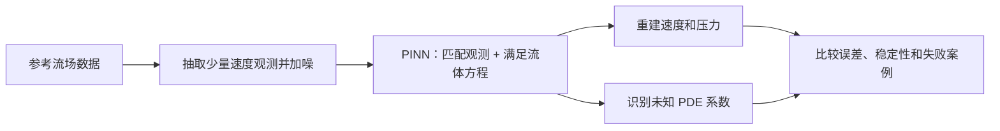
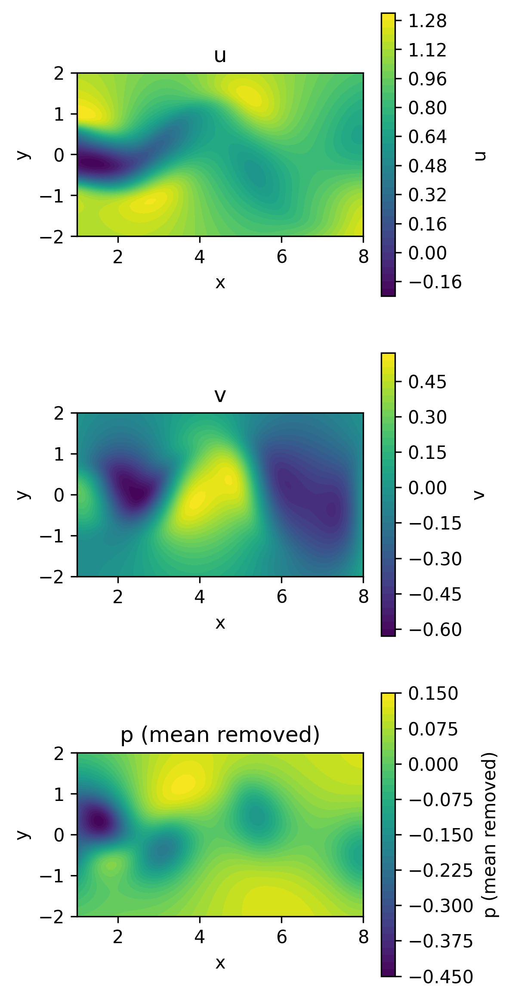
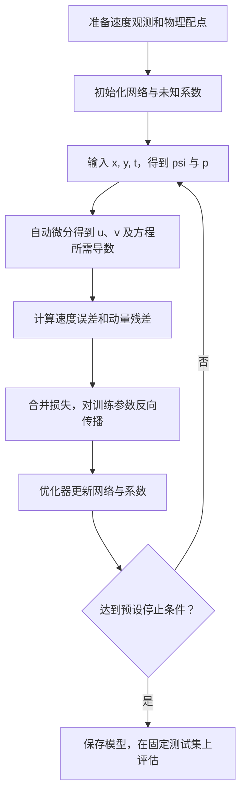

# 从零理解我们的 SciML 项目：用物理规律，从稀疏速度观测中识别流体参数与压力

[English version](PROJECT_GUIDE.en.md)

> **读者**：第一次接触本项目的同学、组员或评阅者。无需预先学过 PINN。
>
> **阅读方式**：先看「两分钟版」建立整体认识，再按顺序理解方程、方法与实验。数学公式使用 GitHub 支持的 LaTeX，流程图使用 Mermaid。
>
> **状态说明｜2026-11-04**：参考数据已经下载并核验，真值快照和动画已经可用。PINN 核心计算、训练与评估仍是待实现的接口；本文中描述的学习效果是研究目标，尚无训练结果证明。

## 两分钟版：我们到底想做什么？

想象水流经过一根圆柱，在圆柱后方形成随时间变化的尾流。我们只在少量位置和时刻知道水流的速度，想回答：

> **能否利用这些速度观测，加上已知的流体方程，推断未观测到的压力、重建更多位置的速度，并识别方程中的未知系数？当观测越来越少、越来越嘈杂时，这种方法还能做到什么程度？**

我们采用的方法叫 **Physics-Informed Neural Network（PINN，物理信息神经网络）**。

它学习一个可以接受空间位置和时间的连续函数。训练时，既要求预测速度接近观测，也要求预测的流场尽量满足 Navier–Stokes 方程。

整个项目可以理解为：



如果阅读器不支持流程图，按下面这条链理解即可：

**参考数据 → 少量带噪速度 → 物理约束训练 → 场重建与参数识别 → 误差和局限性分析。**

我们研究的是方法的表现和边界。得到一张漂亮的流场图，只是其中一个检查环节。

## 目录

1. [物理场景：圆柱后面的流场](#1-物理场景圆柱后面的流场)
2. [已知什么，未知什么？](#2-已知什么未知什么)
3. [Navier–Stokes 方程在说什么？](#3-navierstokes-方程在说什么)
4. [为什么这是一个反问题？](#4-为什么这是一个反问题)
5. [PINN 用什么表示流场？](#5-pinn-用什么表示流场)
6. [怎样把物理规律放进训练？](#6-怎样把物理规律放进训练)
7. [一次训练到底经历哪些步骤？](#7-一次训练到底经历哪些步骤)
8. [没有压力观测，为什么还能尝试重建压力？](#8-没有压力观测为什么还能尝试重建压力)
9. [数据文件里有什么？](#9-数据文件里有什么)
10. [我们准备做哪些实验？](#10-我们准备做哪些实验)
11. [怎样判断结果好不好？](#11-怎样判断结果好不好)
12. [什么情况可能失败？](#12-什么情况可能失败)
13. [仓库里的代码如何对应这些概念？](#13-仓库里的代码如何对应这些概念)
14. [常见问题与下一步](#14-常见问题与下一步)
15. [参考资料](#15-参考资料)

## 1. 物理场景：圆柱后面的流场

水或空气流过圆柱时，后方可能出现交替脱落的旋涡。描述这一现象，需要知道：

- **空间位置**：水平坐标 $x$、竖直坐标 $y$。
- **时间**：$t$。
- **速度**：水平分量 $u(x,y,t)$、竖直分量 $v(x,y,t)$。
- **压力**：$p(x,y,t)$。

这里的「场」，就是在一片区域内，每个位置都对应一个数或向量。例如，一张速度图展示某个时刻各个位置的流动状态；一段动画展示这些数随时间的变化。

本项目采用二维、不可压缩、常黏性系数的模型，并使用原作者提供的圆柱尾流参考数据。

**我们实际研究的区域是圆柱下游的一个矩形窗口：**

$$
x\in[1,8],\qquad y\in[-2,2],\qquad t\in[0,19.9].
$$

这个窗口不包含完整圆柱边界。当前任务是在窗口内利用散布的速度观测进行重建和识别；如果改为从入口、圆柱表面及外边界条件直接求解完整绕流，就需要另行定义完整的正问题。

下面这张图来自已经下载的参考数据：



*图：参考解在 $t=10$ 时的快照。压力已去掉该时刻的空间平均值；空间显示使用三角剖分插值。这张图用于认识数据，尚非 PINN 预测。*

也可以打开 [参考流场动画](../output/reference_animation.html)，同时查看 $u,v,p$ 随时间的变化。在 GitHub 上通常需要下载 HTML 后用浏览器打开，才能使用播放按钮。

## 2. 已知什么，未知什么？

### 2.1 给训练算法的信息

我们给模型一些速度观测：

$$
\mathcal D_u
=\{(x_i,y_i,t_i,u_i^{\mathrm{obs}},v_i^{\mathrm{obs}})\}_{i=1}^{N_u}.
$$

一条记录的含义是：**在 $(x_i,y_i)$ 这个位置、$t_i$ 这个时刻，测到两个方向的速度。**

还告诉模型流体应遵守什么形式的方程，但让其中两个系数由训练估计。

这里「100 个观测点」指 **100 条时空记录**，每条提供 $u,v$ 两个值；不代表 100 个固定传感器各自连续记录了全部 200 个时刻。

### 2.2 希望模型找出的信息

训练后，希望得到：

- **速度重建**：$\hat u(x,y,t)$ 与 $\hat v(x,y,t)$。
- **压力重建**：$\hat p(x,y,t)$，更准确地说，是消除压力参考偏移之后可比较的压力分布。
- **参数识别**：两个全局标量 $\hat\lambda_1,\hat\lambda_2$。

帽子符号 $\hat{\phantom{u}}$ 表示「模型估计值」。下文无帽子的 $u,v,p$ 在物理方程中表示理想流场，在评估公式中表示参考解。

### 2.3 参考数据知道的信息，比训练算法看到的更多

完整文件里有速度、压力和全部时空采样位置。我们作为实验设计者可以看到这些信息，用来构造和检查实验；训练过程只允许使用选定的速度标签与物理方程。

**压力真值用于评估，不放入训练损失；测试速度标签也不用于训练或挑选训练预算。**

这种设计让我们能够检验：模型在没有压力观测的前提下，究竟恢复了多少压力结构。

## 3. Navier–Stokes 方程在说什么？

Navier–Stokes 通常简称 **NS 方程**。对本项目，它主要表达两件事：

1. 流体的动量如何随时间、流动、压力和黏性作用而变化。
2. 不可压缩流体的局部质量守恒。

### 3.1 先读懂符号

- $u_t=\partial u/\partial t$：固定位置处，水平速度随时间的变化率。
- $u_x=\partial u/\partial x$：水平速度沿水平方向的变化率。
- $u_{xx}=\partial^2u/\partial x^2$：水平速度对 $x$ 的二阶导数。
- $p_x,p_y$：压力在两个空间方向的变化率，即压力梯度分量。
- $\nabla$：把空间方向上的求导写在一起的运算符。
- $\nabla^2$：空间拉普拉斯算子，二维中为 $\partial_{xx}+\partial_{yy}$。

「偏导」的意思是：研究某一个变量的变化时，先固定其他变量。

### 3.2 有量纲形式：从熟悉的物理概念出发

在常密度、常黏性系数且不显式加入体积力的条件下，记速度向量为 $\mathbf q=(u,v)$，可写为：

$$
\frac{\partial\mathbf q}{\partial t}
+(\mathbf q\cdot\nabla)\mathbf q
=-\frac{1}{\rho}\nabla p_{\mathrm{phys}}
+\nu\nabla^2\mathbf q,
\qquad
\nabla\cdot\mathbf q=0.
$$

其中 $\rho$ 是密度，$\nu$ 是运动黏度，$p_{\mathrm{phys}}$ 是有物理单位的压力。直观上，这是一条「流体加速度由压力与黏性作用共同决定」的关系。

### 3.3 项目实际使用的无量纲形式

我们采用参考例子的缩放约定，将两个动量方程写成：

$$
\boxed{
u_t+\lambda_1(uu_x+vu_y)
=-p_x+\lambda_2(u_{xx}+u_{yy})
}
$$

$$
\boxed{
v_t+\lambda_1(uv_x+vv_y)
=-p_y+\lambda_2(v_{xx}+v_{yy})
}
$$

不可压缩条件为：

$$
\boxed{u_x+v_y=0.}
$$

这里的 $x,y,t,u,v,p$ 均按参考例子的无量纲约定理解。尤其 $p$ 不是可以直接当作 Pa 使用的原始物理压力。

以第一条动量方程为例：

- **$u_t$：局部时间变化。** 固定某个位置，速度本身正在如何变化？
- **$uu_x+vu_y$：对流。** 流体运动到速度不同的位置时，会经历怎样的速度变化？
- **$-p_x$：压力梯度作用。** 沿水平方向的压力差如何驱动流动？压力值本身与压力梯度是不同的概念。
- **$\lambda_2(u_{xx}+u_{yy})$：黏性扩散。** 黏性如何传递动量、平滑速度差异？

连续性方程 $u_x+v_y=0$ 表示局部净体积流出率为零，**并不意味着速度处处相同，也不意味着速度不随时间变化**。

### 3.4 两个待识别系数分别是什么？

本例参考值为：

$$
\lambda_1^*=1,\qquad\lambda_2^*=0.01.
$$

- $\lambda_1$：对流项前的系数。虽然标准缩放下真值为 1，反问题中仍让模型估计它，检查方程系数能否被识别。
- $\lambda_2$：黏性项前的系数。在该无量纲约定下，$\lambda_2=1/\mathrm{Re}$。

雷诺数定义为：

$$
\mathrm{Re}=\frac{UL}{\nu},
$$

其中 $U,L$ 是速度与长度尺度。$\lambda_2=0.01$ 对应 $\mathrm{Re}=100$。

**因此，我们应称之为「黏性项系数识别」。要把它换回有单位的运动黏度，还需要知道缩放尺度：$\nu=\lambda_2UL$。两个 $\lambda$ 不能一起称为黏度。**

## 4. 为什么这是一个反问题？

**正问题**的典型方向是：已知方程系数和充分的初始、边界条件，计算流场。

**我们的反问题**则是：已有一部分速度观测，反过来推断未知系数和未观测场。

```text
正问题：方程 + 已知参数 + 初始/边界条件 -> 流场
反问题：方程结构 + 部分速度观测 -> 未知参数 + 场重建
```

这两类问题使用的物理关系相同，但给定的信息与求解目标不同。

项目先安排一次「固定真实系数、仍使用速度观测」的重建检查，用来判断网络、求导和损失是否工作。**这属于已知系数的重建检查，不等同于只靠初始/边界条件求解完整绕流的正问题。**

## 5. PINN 用什么表示流场？

### 5.1 网络是一个可求导的函数

将网络记为 $\mathcal N_\theta$，$\theta$ 包含权重与偏置。输入是三个数：

$$
(x,y,t).
$$

输出是两个数：

$$
\mathcal N_\theta(x,y,t)
=\begin{bmatrix}\psi_\theta(x,y,t)\\p_\theta(x,y,t)\end{bmatrix}.
$$

其中 $\psi$ 称为**流函数**。默认网络为 8 个隐藏层、每层 20 个神经元、tanh 激活，使用 float64。

「连续时间 PINN」指网络把时间作为连续输入坐标。训练后可以在窗口内查询不同坐标，但能输出数值，并不代表所有位置都已经足够准确。

### 5.2 为什么输出流函数，而不直接输出两个速度？

我们定义：

$$
\hat u=\frac{\partial\psi_\theta}{\partial y},
\qquad
\hat v=-\frac{\partial\psi_\theta}{\partial x}.
$$

于是：

$$
\hat u_x+\hat v_y
=\psi_{\theta,yx}-\psi_{\theta,xy}=0.
$$

只要函数足够光滑，混合偏导可交换，连续性就由这种表示自动满足。实际浮点计算可能存在数值误差，所以仍应检查散度。

这样，网络输出两个量 $\psi,p$，即可导出 $u,v,p$ 三个场；无需再单独训练一个流函数标签。

### 5.3 自动微分在做什么？

网络由加法、乘法、激活函数等计算组成。自动微分沿计算图应用链式法则，计算输出对输入的导数。

例如，它可以从 $\psi_\theta$ 求出 $\hat u,\hat v$，再进一步求出 $\hat u_t,\hat u_x,\hat u_{xx}$ 等。

这里存在两类不同用途的导数：

- **对坐标求导**：得到速度与 PDE 中的导数。
- **对待训练参数求导**：得到如何修改 $\theta,\lambda_1,\lambda_2$ 才能减小损失。

自动微分计算的是已定义计算图的导数，受浮点精度影响；它不会自动证明这个网络已经是正确的物理解。

还有一个实现细节：$u$ 已经是 $\psi$ 的一阶导数，NS 方程又需要速度的二阶空间导数，因此实际上涉及 $\psi$ 的三阶空间导数。我们采用光滑的 tanh 激活；输入归一化放在网络内部，使链式法则正确包含坐标缩放。

## 6. 怎样把物理规律放进训练？

「物理信息」具体体现为：把网络预测代入方程，衡量它有多不满足方程。

### 6.1 物理残差：方程两边差多少？

将所有项移到左侧，定义：

$$
f_\theta
=\hat u_t+\lambda_1(\hat u\hat u_x+\hat v\hat u_y)
+\hat p_x-\lambda_2(\hat u_{xx}+\hat u_{yy}),
$$

$$
g_\theta
=\hat v_t+\lambda_1(\hat u\hat v_x+\hat v\hat v_y)
+\hat p_y-\lambda_2(\hat v_{xx}+\hat v_{yy}).
$$

若预测严格满足动量方程，残差应为零。训练时只能努力让采样位置上的残差足够小。

这里 $f,g$ 表示方程误差，不是额外加入的外力。

### 6.2 两种点承担不同职责

**观测点**带有速度标签：$(x_i,y_i,t_i,u_i^{\mathrm{obs}},v_i^{\mathrm{obs}})$，用于检查预测与数据是否一致。

**物理配点**只有坐标：$\mathbf z_j^f=(x_j^f,y_j^f,t_j^f)$，用于计算 $f,g$。我们可以在没有速度测量的位置施加物理约束。

所以「100 条速度观测 + 5,000 个物理配点」仍然只使用 100 条带标签的速度观测，不能算作 5,100 条速度测量。

### 6.3 数据损失：预测是否接近测量？

记 $\mathbf z_i=(x_i,y_i,t_i)$，定义：

$$
\mathcal L_{\mathrm{data}}
=\frac{1}{N_u}\sum_{i=1}^{N_u}
\left[
\big(\hat u(\mathbf z_i)-u_i^{\mathrm{obs}}\big)^2
+\big(\hat v(\mathbf z_i)-v_i^{\mathrm{obs}}\big)^2
\right].
$$

这项越小，模型在观测点上越接近给定的速度标签。标签包含噪声时，完全拟合标签也可能是在拟合噪声。

### 6.4 物理损失：预测是否接近满足方程？

$$
\mathcal L_{\mathrm{physics}}
=\frac{1}{N_f}\sum_{j=1}^{N_f}
\left[f_\theta(\mathbf z_j^f)^2+g_\theta(\mathbf z_j^f)^2\right].
$$

项目默认总损失为：

$$
\boxed{\mathcal L=\mathcal L_{\mathrm{data}}+\mathcal L_{\mathrm{physics}}.}
$$

两个均值分别按各自点数归一化，避免仅因配点更多就直接扩大物理项权重。即使系数都取 1，两项的实际数值尺度也可能不同，因此需要分别记录它们。

我们的流函数表示已处理连续性；当前默认目标不额外加入散度损失，也不加入压力标签损失。

### 6.5 模型同时调整什么？

反问题中优化的是：

$$
\min_{\theta,\lambda_1,\lambda_2}\mathcal L.
$$

网络参数 $\theta$ 控制流场的形状；$\lambda_1,\lambda_2$ 是整个窗口共享的两个标量，控制 PDE 项之间的关系。

它们共同被更新，意味着网络既可能通过改变场来减小残差，也可能通过改变系数来减小残差。这也是为什么低损失本身不足以保证正确识别系数。

## 7. 一次训练到底经历哪些步骤？



用接近伪代码的方式表达：

```text
输入：速度观测、物理配点、网络配置、随机种子、训练预算

初始化网络参数 theta
若为反问题：初始化并学习 lambda1、lambda2
若为已知系数检查：固定 lambda1=1、lambda2=0.01

重复执行预设的优化过程：
    网络接收坐标，输出 psi 和 p
    对坐标自动微分，得到 u、v 及 PDE 所需导数
    计算观测点的数据损失
    计算配点的物理损失
    对总损失求训练参数梯度
    优化器更新待训练参数
    按约定保存日志和 checkpoint

保存最终状态
仅在评估阶段读取留出的参考速度与压力标签
输出参数误差、场误差、耗时、图和失败记录
```

默认训练起点是 Adam 50,000 步，随后 L-BFGS 最多 10,000 次迭代。Adam 用于前期优化，L-BFGS 用于后续精化；这是待验证的预算，不代表一定能收敛。

L-BFGS 一次迭代可能多次调用损失计算函数，因此日志需要区分「迭代次数」与「损失函数调用次数」。

**训练中的迭代编号，不是流体的物理时间。** 网络在一次训练中学习整个选定时空窗口内的函数，并非每次优化只向后预测一帧。

## 8. 没有压力观测，为什么还能尝试重建压力？

### 8.1 方程把压力梯度与速度联系起来

将第一条动量方程整理，可得：

$$
p_x=-u_t-\lambda_1(uu_x+vu_y)
+\lambda_2(u_{xx}+u_{yy}).
$$

另一个方向同理：

$$
p_y=-v_t-\lambda_1(uv_x+vv_y)
+\lambda_2(v_{xx}+v_{yy}).
$$

这说明，速度的时空结构和 PDE 系数能够约束压力的空间变化。PINN 在联合训练中利用这种耦合，使压力参与解释速度观测。

这里的「能够约束」不等于一定能唯一、准确地恢复。速度观测太少、噪声过大或系数估计不准时，压力重建也可能失败。

### 8.2 压力存在参考偏移不唯一性

在当前只含压力空间梯度的方程和观测设置下，如果：

$$
\tilde p(x,y,t)=p(x,y,t)+C(t),
$$

那么 $\tilde p_x=p_x$、$\tilde p_y=p_y$。因此，单靠这些速度观测和方程，无法确定任意随时间变化的整体压力偏移。

例如，同一帧中 $p$ 与 $p+5$ 会产生相同的压力梯度。直接比较它们的绝对数值，会把无法识别的偏移误算成场重建错误。

**评估时，我们在每个时刻分别减去预测和真值的空间均值，再比较压力分布。**

这属于固定压力参考的评估约定，不是用压力真值训练模型。现有参考动画也采用逐时刻去均值，便于展示相对压力结构。

## 9. 数据文件里有什么？

数据来自原作者仓库的 `cylinder_nektar_wake.mat`，项目中存放于：

```text
data/raw/cylinder_nektar_wake.mat
```

文件包含：

- **`X_star`，形状 `(5000, 2)`**：5,000 个空间位置，两列为 $x,y$。
- **`t`，形状 `(200, 1)`**：200 个离散时刻。
- **`U_star`，形状 `(5000, 2, 200)`**：依次为「空间点、速度分量、时间」。分量 0 是 $u$，分量 1 是 $v$。
- **`p_star`，形状 `(5000, 200)`**：依次为「空间点、时间」。

因此，参考文件共有 $5000\times200=1,000,000$ 个时空采样位置，但稀疏实验只向模型提供其中很少的速度标签。

例如：

```python
# k=100 是从零开始的索引，对应 t=10
u = data["U_star"][:, 0, 100]
v = data["U_star"][:, 1, 100]
p = data["p_star"][:, 100]
```

文件中的数值作为本项目的**参考解**使用。称它们为「真值」是实验约定，并不意味着它们没有数值模拟误差。

原始数据应保留不变。抽样、加噪与压力中心化使用工作副本，同时保存索引、种子和变换记录。

## 10. 我们准备做哪些实验？

所有数量是当前配置中的计划，尚未执行正式训练。

### 10.1 第一步：实现检查，1 次

固定 $\lambda_1=1,\lambda_2=0.01$，使用 5,000 条无噪声速度观测，检查模型能否完成合理的场重建。

这一阶段优先排查数据轴顺序、导数符号、坐标缩放和损失实现。

### 10.2 第二步：参考方法复现，6 次

使用 5,000 条速度观测，在 0% 与 1% 噪声下分别运行 3 个随机种子。

这组实验沿用参考方法「在观测坐标上计算物理残差」的做法，建立反问题基线。我们的 PyTorch、精度、留出评估和训练预算与原实现存在差异，需要在报告中列明；不承诺逐数值一致。

### 10.3 第三步：噪声敏感性

固定 $N_u=100$，比较噪声比例：

$$
\alpha\in\{0,0.01,0.05,0.10\}.
$$

每种条件运行 3 个随机种子。

以水平速度为例，加噪规则为：

$$
u_i^{\mathrm{obs}}
=u_i+\alpha\,\sigma_{u,\mathrm{clean}}\,\epsilon_{u,i},
\qquad\epsilon_{u,i}\sim\mathcal N(0,1).
$$

$v$ 使用自身无噪声训练观测的标准差和对应随机噪声。5% 指噪声标准差为该速度分量样本标准差的 5%，不是每一个速度值固定偏差 5%。

同一个重复种子下，共用观测位置、网络初始化和基础噪声，只改变比例。

### 10.4 第四步：稀疏性敏感性

固定 5% 噪声，比较：

$$
N_u\in\{50,100,200\}.
$$

每种条件运行 3 个随机种子。50 条记录是 100 条的子集，100 条又是 200 条的子集，减少样本位置完全不同带来的干扰。

$N_u=100$、5% 噪声这一个条件与上一组共用，所以两类敏感性实验合计 **6 个不同条件 × 3 个种子 = 18 次**。

总计划是 **1 次实现检查 + 6 次复现 + 18 次敏感性实验 = 25 次训练**。

### 10.5 为什么主实验固定额外物理配点？

如果减少速度标签的同时，也减少 PDE 配点，结果就会同时受到「观测变少」与「物理约束覆盖变少」的影响。

因此，主敏感性实验固定 5,000 个额外的无标签配点。这个设置是我们相对参考实验的调整，需明确报告。

测试集也预先固定，按时刻分层，默认每个时刻留出 500 个空间样本。所有运行使用相同测试集，标签保持无噪声。

### 10.6 为什么需要多个随机种子？

一次运行可能恰好抽到更有信息的观测，或得到更有利的初始化。只展示最好的一次，会高估方法的稳定性。

我们的三个重复同时改变初始化、观测抽样和噪声，实现整体重复性检查。汇总均值、样本标准差和单次结果；这不能单独分解出三种随机因素各自造成多少方差。

## 11. 怎样判断结果好不好？

### 11.1 参数识别：系数是否接近参考值？

$$
E_{\lambda_1}=\frac{|\hat\lambda_1-1|}{1},
\qquad
E_{\lambda_2}=\frac{|\hat\lambda_2-0.01|}{0.01}.
$$

报告百分比时再乘 $100\%$。

**仅作算式示例，不是实验结果**：如果 $\hat\lambda_2=0.012$，相对误差就是 $0.002/0.01=20\%$。这说明数值上很小的绝对偏差，对较小的黏性系数也可能是明显误差。

### 11.2 速度重建：未参与训练的位置是否准确？

在固定测试集 $\mathcal T$ 上，分别计算：

$$
E_u=\frac{\sqrt{\sum_{i\in\mathcal T}(\hat u_i-u_i)^2}}
{\sqrt{\sum_{i\in\mathcal T}u_i^2}},
\qquad
E_v=\frac{\sqrt{\sum_{i\in\mathcal T}(\hat v_i-v_i)^2}}
{\sqrt{\sum_{i\in\mathcal T}v_i^2}}.
$$

不能只看训练观测点上的误差。对观测拟合得好，未观测区域仍可能重建得差。

### 11.3 压力重建：先去掉不可识别的时间偏移

对每个时间索引 $k$，记该帧测试集为 $\mathcal T_k$，定义：

$$
p^c_{i,k}=p_{i,k}-\frac{1}{|\mathcal T_k|}\sum_{j\in\mathcal T_k}p_{j,k},
\qquad
\hat p^c_{i,k}=\hat p_{i,k}-\frac{1}{|\mathcal T_k|}\sum_{j\in\mathcal T_k}\hat p_{j,k}.
$$

随后计算所有时刻中心化结果的整体相对误差：

$$
E_p=\frac{\sqrt{\sum_k\sum_{i\in\mathcal T_k}(\hat p^c_{i,k}-p^c_{i,k})^2}}
{\sqrt{\sum_k\sum_{i\in\mathcal T_k}(p^c_{i,k})^2}}.
$$

若某个相对指标的参考范数为零，应显式报告无法定义，不能把它当作零误差。

### 11.4 稳定性与计算成本

还需记录：

- 数据损失和物理损失各自的收敛过程。
- 两个系数随优化迭代的变化。
- 每次运行的耗时、是否收敛、是否出现非物理估计或数值异常。
- 三次重复的均值、样本标准差、实际有效数量和失败记录。
- 固定时刻的真值、预测和误差图，使用一致的对比色标。

**速度误差、压力误差、参数误差和训练损失回答的是不同问题，必须分别查看。**

## 12. 什么情况可能失败？

我们预期研究中可能出现以下情况，是否发生须由真实实验判断：

1. **观测没有覆盖关键结构。** 少量随机样本可能错过旋涡核心或重要时间变化，导致有多种场都能解释观测。
2. **噪声干扰导数与参数识别。** 速度拟合误差小，不意味着高阶导数准确；黏性项又直接依赖速度的二阶空间导数。
3. **损失项的优化难度不同。** 网络可能先拟合速度，但方程残差仍大，或相反。
4. **参数与场可以相互补偿。** 在有限采样处，一组不准确的系数与一个不准确的场也可能产生较小残差。
5. **训练预算不足或优化停滞。** 不同初始化可能收敛到不同结果；不能把所有失败立即解释为方法本身不适用。
6. **配点之外缺少保证。** 有限配点残差小，不代表整个连续区域残差都小。

需要区分两类问题：**实现错误**应修正；在实现检查通过后，**方法在特定数据条件下表现差**本身就是应当保留和分析的实验结果。

如果出现负的黏性项系数，应记录为非物理估计并排查原因。不能据此解释为流体具有负黏度。

我们也不预设误差一定随着噪声严格单调上升。有限重复、优化差异和采样变化都可能影响曲线；结论要与实际证据匹配。

## 13. 仓库里的代码如何对应这些概念？

### 已有可用部分

- [`sciml/config.py`](../sciml/config.py)：默认参数、配置检查、JSON 读写、25 次实验定义。
- [`sciml/cli.py`](../sciml/cli.py)：命令行参数与模块调用入口。科研计算子命令目前仍指向待实现接口。
- [`scripts/testing_data_plot.py`](../scripts/testing_data_plot.py)：从参考文件绘制一个时刻的静态快照。
- [`scripts/animate_reference.py`](../scripts/animate_reference.py)：绘制参考 $u,v,p$ 同步变化的动画。
- [配置导出脚本](../scripts/export_configs.py)：需要正式实验时生成配置和顺序清单。

### 按下面顺序实现的核心模块

1. [`data.py`](../sciml/data.py)：读取原始数组，划分测试集、嵌套抽样、加噪、准备配点。
2. [`model.py`](../sciml/model.py)：从坐标输出流函数和压力，管理固定或可训练系数。
3. [`physics.py`](../sciml/physics.py)：自动微分、速度恢复、动量残差。
4. [`losses.py`](../sciml/losses.py)：将数据误差与物理残差组合成可微损失。
5. [`train.py`](../sciml/train.py)：优化、日志、checkpoint、恢复和失败记录。
6. [`evaluate.py`](../sciml/evaluate.py)：固定测试集指标、压力参考处理与预测保存。
7. [`plotting.py`](../sciml/plotting.py)：根据已有日志画单次训练曲线。

这些核心模块当前是接口骨架，具体实现由小组完成。

### 最重要的验收检查

- 用可解析函数验证坐标导数、速度符号、连续性和动量残差。
- 检查梯度是否能传到网络和两个未知系数。
- 检查训练/测试分离、噪声规则、观测嵌套与配点共享。
- 向预测压力加入任意 $C(t)$ 后，中心化压力误差应保持不变。
- 重新载入 checkpoint 应复现预测，恢复训练应正确恢复优化器状态。
- 统计程序必须保留失败信息，排除 smoke/pilot 结果。

已有自动检查见 [tests](../tests)。训练流程通过测试并不代表模型预测准确。

## 14. 常见问题与下一步

### Q：我们是在让模型发现完整的 NS 方程吗？

目前已经给定方程结构，只估计其中两个系数。这属于参数识别，并非从任意候选表达式中发现未知方程结构。

### Q：我们需要自己先写 CFD 求解器吗？

当前使用作者提供的参考解构造实验，无需先自己完成圆柱绕流 CFD 仿真。若以后改变雷诺数、几何或边界条件，则需要相应的新参考数据或新求解流程。

### Q：为什么不把完整速度、压力都给模型？

因为研究问题就是稀疏速度条件下的推断能力。提供全部标签会改变问题，也无法检验没有压力观测时的压力重建。

### Q：物理方程是不是能补上任何缺失数据？

方程提供约束，但有限观测下仍可能不充分，特别是没有覆盖关键信息、存在噪声或优化困难时。是否能够恢复，需要实验检验。

### Q：能否直接预测窗口以外或其他雷诺数的流动？

当前网络只针对本数据窗口训练，雷诺数等参数也不是用于跨工况查询的网络输入。外推、改变几何或跨雷诺数泛化，需要另外的设计与验证。

### Q：现在完成到哪一步？

参考数据检查、静态快照、动画、配置与仓库骨架已就绪。下一步是实现数据准备和 PINN 核心计算，先通过解析测试与已知系数检查，再开展反问题复现。

### Q：最终要给出什么？

最终应形成一条可复查的证据链：**明确定义的问题 → 可解释的算法与伪代码 → 多次重复的实验 → 参数/场误差与失败分析 → 可复现代码和记录**，并整理为报告、slides 和约 10 分钟的全员展示。

后续执行参考 [实施清单](ROADMAP.md)，实现细节参考 [接口与实验约定](DESIGN.md)。

## 15. 参考资料

本文中的直观说明与代数推导用于帮助阅读。方法来源与本组具体设置分开列出：

1. **原论文**：Raissi, M., Perdikaris, P., & Karniadakis, G. E. (2019). *Physics-informed neural networks: A deep learning framework for solving forward and inverse problems involving nonlinear partial differential equations*. Journal of Computational Physics, 378, 686–707。[论文 DOI](https://doi.org/10.1016/j.jcp.2018.10.045)。
2. **作者方法说明**：流函数表示、连续时间反问题与速度/压力示例，见 [Physics Informed Deep Learning](https://maziarraissi.github.io/PINNs/)。
3. **作者参考代码**：见 [NavierStokes.py](https://github.com/maziarraissi/PINNs/blob/master/main/continuous_time_identification%20%28Navier-Stokes%29/NavierStokes.py)。本组的 PyTorch、float64、训练预算、独立测试和额外配点属于需要明示的实现或实验调整。
4. **参考数据**：见 [cylinder_nektar_wake.mat](https://github.com/maziarraissi/PINNs/blob/master/main/Data/cylinder_nektar_wake.mat)。数组形状与范围已在本地核验；下载来源和哈希记录于数据目录中的来源清单。
5. **本组约定**：见 [DESIGN.md](DESIGN.md) 和 [实验配置](../configs/README.md)，它们描述计划中的实验，不代表已经取得的结果。
